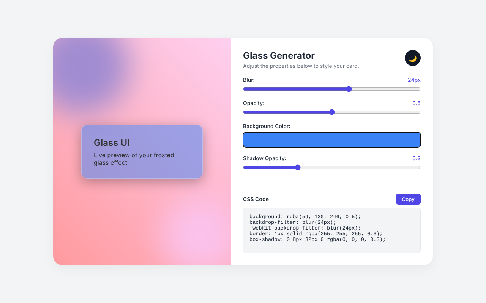

# Glassmorphism UI Generator

A lightweight, real-time visual editor for generating CSS Glassmorphism (frosted glass) UI components. Built with HTML5, CSS3, and Vanilla JavaScript.

## 🚀 Features

- **Live Preview:** See changes to your frosted glass card in real-time over a vibrant, dynamic background.
- **Interactive Controls:** - Adjust background blur (`backdrop-filter`)
  - Tweak opacity and transparency
  - Select background colors (HEX to RGBA conversion)
  - Control shadow depths
- **Instant Code Export:** Automatically generates the exact CSS required. Includes cross-browser support (`-webkit-backdrop-filter`) and a 1-click "Copy to Clipboard" button.
- **Responsive Design:** Optimized layout for both desktop and mobile screens utilizing modern CSS Custom Properties.

## 🛠️ Tech Stack

- **HTML5:** Semantic structure.
- **CSS3:** Heavy utilization of CSS Variables (`:root`), Flexbox, and minimal card-based layout principles.
- **Vanilla JavaScript:** Zero dependencies. Handles DOM manipulation, HEX to RGB conversion, and Clipboard API interactions.

## 📥 Run locally

- **Entry point:** `public/Glassmorphism-Generator/index.html`. It is a plain static page with no build step and no dependencies.
- **Setup command** (from the repository root):
  ```bash
  npm run dev
  ```
  This runs `npx -y serve . -p 3000`. Then open <http://localhost:3000/public/Glassmorphism-Generator/>.
  Opening `index.html` directly in a browser also works.

## 🧪 Tested walkthrough

The steps below are run by a browser test, `tests/course/r60-t007.mjs`, which reads this table and checks every expected result against the live page. If the page and this walkthrough ever disagree, the test fails.



<!-- walkthrough:start -->
| Step | What you do | Action | Expected result |
| --- | --- | --- | --- |
| 1 | Open the page in a 1280×800 window | `open 1280x800` | `text #blur-val = 10px` · `css #preview-card backdrop-filter = blur(10px)` · `value #css-output contains backdrop-filter: blur(10px);` · `left-of .preview-section .controls-section` |
| 2 | Drag **Blur** to 24 | `fill #blur 24` | `text #blur-val = 24px` · `css #preview-card backdrop-filter = blur(24px)` · `value #css-output contains backdrop-filter: blur(24px);` · `value #css-output contains -webkit-backdrop-filter: blur(24px);` |
| 3 | Drag **Opacity** to 0.5 | `fill #opacity 0.5` | `text #opacity-val = 0.5` · `css #preview-card background-color = rgba(255, 255, 255, 0.5)` |
| 4 | Pick the background colour `#3b82f6` | `fill #color #3b82f6` | `css #preview-card background-color = rgba(59, 130, 246, 0.5)` · `value #css-output contains background: rgba(59, 130, 246, 0.5);` |
| 5 | Click **Copy** (the test stubs the clipboard) | `click #copy-btn` | `text #copy-btn = Copied!` · `copied contains background: rgba(59, 130, 246, 0.5);` |
| 6 | Click the 🌙 theme button | `click #theme-toggle` | `class body has dark` · `text #theme-toggle = ☀️` · `css #preview-card backdrop-filter = blur(24px)` |
| 7 | Click it again | `click #theme-toggle` | `class body lacks dark` · `text #theme-toggle = 🌙` |
| 8 | Narrow the window to 390×844 (layout observation) | `viewport 390x844` | `above .preview-section .controls-section` |
<!-- walkthrough:end -->

**Layout observation:** at 768px and wider, the preview sits to the left of the controls. Below 768px, it stacks above them.

Run the test from the repository root:

```bash
npm --prefix tests/course ci
npx --prefix tests/course playwright install chromium   # first time only
node tests/course/r60-t007.mjs
```

It exits non-zero if any step's result differs or the page logs an error. Run `node tests/course/r60-t007.mjs --update-docs-screenshot` to refresh the screenshot above.
