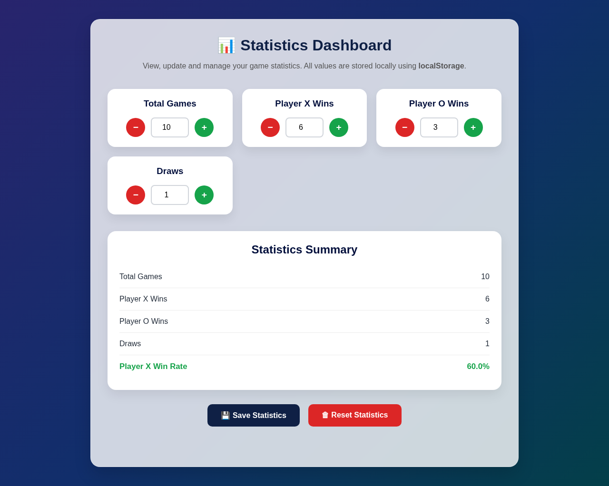
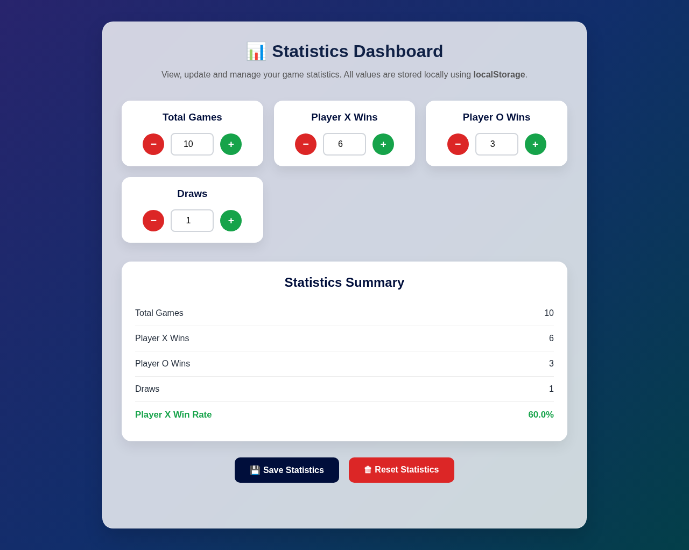

# R60-T040 evidence

Issue: https://github.com/S-AI-Projects/100_days_100_web_project/issues/40

Baseline source: `038e8b7697e6c424b79219312874797421822f82`.

## Inputs and expected behavior

Fill total=10, X=6, O=3, draws=1; assert live 60.0% summary, save/reload and reset. In an isolated response fixture rename only the input event binding; the same live-summary assertion must reject the stale 0% display. No application mutation is saved.

## Reproduction and results

Run `node tests/course/r60-t040.mjs` after the setup in the example README.

`baseline.json` and `after.json` record actual values, expected values, Node/Playwright/Chromium versions, errors and exit status. PNG files support the assertions. The workflow runs the same check against the original example first, restores the PR source, runs the changed check, and uploads this directory as an artifact. The test deliberately exits nonzero on assertion failure.

The local macOS sandbox blocks Chromium startup (MachPortRendezvous permission denied), so local browser success is not claimed. See the attached GitHub Actions run for executed browser results. Source syntax checks were run locally.

No real device or permission-dependent feature was exercised. Keep this coursework evidence in the organisation fork only.

## Verified results

Browser run: https://github.com/ayushisinha111106-cpu/100_days_100_web_project/actions/runs/45243255912

| Phase | Result | Recorded checks |
| --- | --- | --- |
| Baseline | passed | 6 |
| Final | passed | 6 |

Tool versions: Node.js v24.22.3, Playwright 1.61.1, Chromium 149.0.7827.55.

The JSON files contain the exact inputs, expected/actual values and failure details. A failing baseline is an observed application regression, not a passing result. The final check exited 0.

### Before

### After

